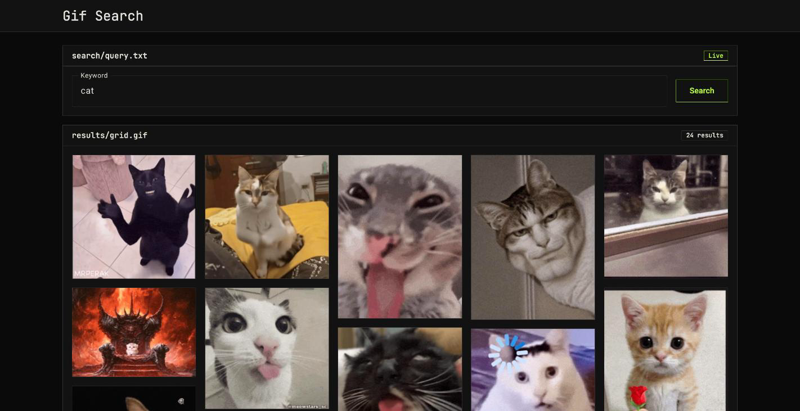

# GIF Search

A single-page app for searching GIFs on [Giphy](https://giphy.com/), opening a GIF's details page,
copying its link and downloading it.



## Live demo

https://wavetunes.github.io/gif-search/

`.github/workflows/deploy.yml` lints, tests and builds the app, then deploys it to GitHub Pages on
every push to `main`. Enable it once under **Settings → Pages → Source: GitHub Actions**. The build
uses the repository name as `--base-href`, and a copy of `index.html` served as `404.html` makes
deep links such as `/gif/<id>` work.

## Features

- Trending GIFs on the start page, before anything is searched.
- Search by keyword; the query lives in the URL (`?q=cat`), so a reload or a shared link restores it.
- Responsive masonry grid that keeps the API's order, with **Load more** up to Giphy's offset limit.
- Loading, empty and error states, with **Try again** on errors.
- Details page at `/gif/:id`: the GIF, title, author with avatar, creation and upload dates, rating
  and dimensions — whatever Giphy returns; missing fields are simply left out.
- **Copy link** copies the details page's address (without the search query); **Download** saves
  the original `.gif` under a readable file name.
- Light and dark themes: the OS preference by default, the header toggle remembers the choice.
- Coming back from a GIF's details restores the loaded results and the scroll position.

## Stack

- Angular 21 — standalone components, signals, `rxResource`, zoneless, lazy routes
- Angular Material
- Giphy API, called straight from the browser (no backend)
- Vitest for unit tests, angular-eslint, Prettier

### Decisions

- Raw Giphy responses are mapped to the app's own models once, in `src/app/core/api/`.
- The grid shows Giphy's animated WebP renditions (several times lighter than GIF); the download
  is always the original `.gif`.
- Search and trending results are limited to `rating=pg-13`.

## Getting a Giphy API key

A working public client-side key already ships in the repo, so the app runs out of the box. Giphy
limits such keys to roughly 100 requests per hour; past that the app shows a rate-limit message.

To use your own key:

1. Sign in at the [Giphy developers portal](https://developers.giphy.com/) and create an app
   (choose the **API** option).
2. Copy the API key it gives you.
3. Put it in `giphyApiKey` in `src/environments/environment.ts`.

## Install and run

Requires Node.js 20.19+ / 22.12+ / 24 and npm.

```bash
npm ci
npm start
```

Open http://localhost:4200/.

## Tests and checks

```bash
npx ng test --watch=false   # unit tests
npx ng lint                 # angular-eslint
npx prettier --check .      # formatting
npx ng build                # production build
```
